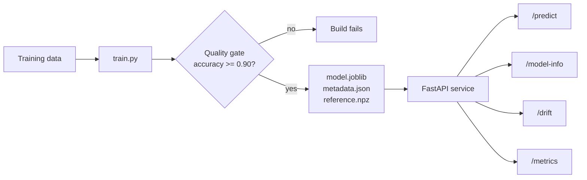

# MLOps Mini Pipeline: Train, Gate, Version, Serve and Monitor a Model

Most ML projects stop at a notebook. This repository takes a small model all the way to a production-style service, with the pieces a real team expects:

* **Reproducible training** with a fixed seed and a data fingerprint
* **A quality gate**: the build fails if test accuracy drops below a threshold
* **Versioned artifacts**: model file + metadata (version, metrics, data hash, library versions)
* **A FastAPI service** with input validation, batch prediction and model info
* **Monitoring**: latency and request counters in Prometheus text format, and a **drift check** (Population Stability Index)
* **Tests, linting, Docker and GitHub Actions CI**

The model itself is deliberately simple (logistic regression on the UCI Wine data, 13 chemical features, 3 cultivars) so the focus stays on the engineering around it. Swap in any scikit-learn pipeline in `src/mlpipe/train.py`.



## Results

**Training** (`results/train_output.json`):

| Metric | Value |
|---|---|
| 5-fold CV accuracy (training split) | 0.985 ± 0.019 |
| Test accuracy (45 held-out samples) | 1.000 |
| Test macro-F1 | 1.000 |
| Quality gate (min. test accuracy 0.90) | passed |

**Serving** on a 2-core CPU, single uvicorn worker, measured with `scripts/load_test.py`:

| Load | Throughput | p50 latency | p95 latency | p99 latency |
|---|---|---|---|---|
| 1,000 requests, 1 row each | 411 req/s | 2.3 ms | 3.0 ms | 4.6 ms |
| 300 requests, 100 rows each | 262 req/s (≈26,000 rows/s) | 3.8 ms | 4.6 ms | 5.1 ms |

Latencies are measured from the client, including HTTP overhead.

**Drift check** (`results/drift_example.json`): sending the original data back gives a worst-feature PSI of 0.03 ("none"). Adding 2 percentage points to every wine's alcohol content gives a PSI of 5.56 on `alcohol` ("major"), so the service flags the shift and names the feature.

### What I learned

* **A quality gate turns a metric into a contract.** Training raises an error instead of saving a weaker model, so neither CI nor the Docker build can ship it by accident.
* **Store the metadata with the model.** `/model-info` answers "which model is this, trained on what, and how good was it?" without opening a notebook.
* **Validate at the edge.** Wrong row widths, NaN values and empty batches are rejected with a clear 422 message before they reach the model.
* **Batching matters.** Sending 100 rows per request costs only about 1.5 ms more than 1 row, so batch clients get roughly 60× more predictions per second.
* **A perfect test score on 45 samples is not proof of a perfect model.** Cross-validation (0.985) is the more honest estimate, which is why both are recorded.

## API

| Method | Path | Description |
|---|---|---|
| GET | `/health` | Liveness and whether the model is loaded |
| GET | `/model-info` | Version, training time, metrics, features, data fingerprint |
| POST | `/predict` | Batch prediction: `{"instances": [[13 numbers], ...]}` (max 1,000 rows) |
| POST | `/drift` | PSI per feature for a batch of at least 30 rows, compared with the training data |
| GET | `/metrics` | Request counters and latency quantiles (Prometheus text format) |

Interactive docs are at `http://127.0.0.1:8000/docs` once the server is running.

```bash
curl -X POST http://127.0.0.1:8000/predict -H 'Content-Type: application/json' \
  -d '{"instances": [[13.2,1.78,2.14,11.2,100,2.65,2.76,0.26,1.28,4.38,1.05,3.4,1050]]}'
```

```json
{"model_version": "1.0.0+20261125203715",
 "predictions": [{"label": 0, "class_name": "class_0",
                  "probabilities": {"class_0": 0.9917, "class_1": 0.0081, "class_2": 0.0002}}]}
```

## Run it

```bash
make install      # pip install -r requirements-dev.txt
make train        # trains, checks the gate, writes models/
make test         # 12 tests: training, gate, drift, every endpoint, bad inputs
make lint         # ruff
make serve        # http://127.0.0.1:8000
make load-test    # in a second terminal
```

With Docker (the image trains the model during the build, so a failed gate means a failed build):

```bash
make docker-build
make docker-run
```

## Continuous integration

`.github/workflows/ci.yml` runs on every push and pull request:

1. Lint with ruff, train with the quality gate, and run the tests on Python 3.11 and 3.12.
2. Build the Docker image, start the container, and smoke-test `/health` and `/predict`.

## Layout

```
src/mlpipe/config.py   paths and the quality-gate threshold (MODEL_DIR, MIN_ACCURACY env vars)
src/mlpipe/train.py    training, evaluation, quality gate, versioned artifacts
src/mlpipe/app.py      FastAPI service with validation, metrics and drift endpoint
src/mlpipe/drift.py    Population Stability Index
scripts/load_test.py   latency and throughput test
tests/                 unit and API tests (FastAPI TestClient)
Dockerfile, Makefile, .github/workflows/ci.yml
```

## Next steps

* Track experiments and register models with MLflow instead of a local folder.
* Add a shadow-deployment mode that logs a candidate model's predictions next to the live model's.
* Schedule the drift check on logged traffic and open an issue automatically when PSI > 0.25.

## Author

**Kazi Rezwan Rashid**, Lecturer in Computer Science and Engineering, Siddheswari University College, Dhaka.
[LinkedIn](https://www.linkedin.com/in/rezwan.rashid) · [Website](https://rezwanrashid.pythonanywhere.com/)

Licensed under the MIT License.
